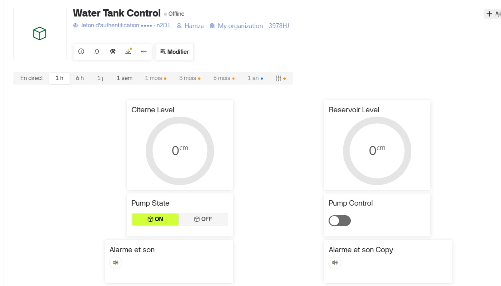

# 💧 Wireless Water Management System (ESP32 + ESP-NOW)

A low-cost, **fully offline** wireless controller for a **cistern → pump → rooftop tank** installation: automatic tank filling, dry-run protection, overflow prevention and a local status display. All decisions are taken locally over **ESP-NOW**: no router, no Internet, no cloud.

An **optional Blynk add-on** provides remote monitoring and manual pump control when WiFi is available. It is disabled by default and is not needed for the system to work.

Built as a proof of concept during a summer internship (July – August 2026) at **H2A GROUP**, Sousse, Tunisia, as part of an Industrial Electronics Engineering program at the National Engineering School of Sousse (ENISo).

## Background

In Tunisia, water stress and scheduled or unexpected supply cuts mean most households rely on a buried cistern, a pump and a rooftop tank, usually operated by hand. This causes three recurring problems:

1. The pump runs dry when the cistern is empty, which damages it.
2. The tank overflows, wasting water.
3. The user has no real-time visibility on the installation.

## Architecture

Four ESP32 nodes communicate peer-to-peer over ESP-NOW:

```
 ┌──────────────┐   ESP-NOW    ┌──────────────────┐   ESP-NOW   ┌───────────────┐
 │ Node 1       │ ───────────▶ │ Node 3           │ ──────────▶ │ Node 4        │
 │ Cistern      │              │ Pump controller  │             │ Display       │
 │ (HC-SR04)    │              │ (relay)          │             │ (OLED SSD1306)│
 └──────────────┘              │                  │             └───────────────┘
 ┌──────────────┐   ESP-NOW    │  optional:       │
 │ Node 2       │ ───────────▶ │  WiFi ◀▶ Blynk   │
 │ Reservoir    │              └──────────────────┘
 │ (HC-SR04)    │
 └──────────────┘
```

| Node | Folder | Role |
|------|--------|------|
| 1 – Cistern | `firmware/node1_cistern` | Measures the cistern water level (HC-SR04) and sends it to the controller |
| 2 – Reservoir | `firmware/node2_reservoir` | Measures the reservoir water level (HC-SR04) and sends it to the controller |
| 3 – Controller | `firmware/node3_controller` | Receives both levels, decides the pump state, drives the relay, sends the state to the display (and to Blynk if enabled) |
| 4 – Display | `firmware/node4_display` | Shows levels, pump state and alerts on an OLED screen |

## Control logic (node 3)

In order of priority:

1. **Manual command** (Blynk add-on only, *Pump Control* button on V3): overrides everything else.
2. Pump **OFF** if a sensor node has not sent a frame for more than 3 s.
3. Pump **OFF** if a sensor reports a measurement error.
4. Pump **OFF** (*dry run*) if the cistern level is ≤ `DRY_RUN_LEVEL` (2.5 cm).
5. Pump **OFF** (*overflow*) if the reservoir level is ≥ `OVERFLOW_LEVEL` (8.0 cm).
6. Otherwise, pump **ON**.

The relay is **active LOW** (`LOW` = pump ON) and the pump is OFF at boot.

## Hardware

- 4 × ESP32 development boards
- 2 × HC-SR04 ultrasonic sensors
- 1 × relay module (active LOW) and a pump
- 1 × SSD1306 128×64 I²C OLED display (address `0x3C`)

### Pinout

| Node | Signal | GPIO |
|------|--------|------|
| 1 and 2 | HC-SR04 TRIG | 5 |
| 1 and 2 | HC-SR04 ECHO | 18 |
| 3 | Relay IN | 26 |
| 4 | OLED SDA | 21 |
| 4 | OLED SCL | 22 |

> ⚠️ The HC-SR04 runs at 5 V: the ECHO line needs a voltage divider or level shifter before the 3.3 V ESP32 input. Mains wiring on the pump side must be done with proper electrical safety.

## Getting started

### Requirements

- [Arduino IDE](https://www.arduino.cc/en/software) with the **ESP32** board package (Espressif)
- Libraries: `Adafruit GFX Library`, `Adafruit SSD1306` (and `Blynk` only for the optional add-on)

### Steps

1. **Get the MAC addresses** of nodes 3 and 4 (e.g. print `WiFi.macAddress()`), then update:
   - `receiverMAC` in `node1_cistern` and `node2_reservoir` → MAC of **node 3**;
   - `displayMAC` in `node3_controller` → MAC of **node 4**.
2. **Calibrate** `SENSOR_HEIGHT` and `TANK_HEIGHT` (cm) in nodes 1 and 2 for your tanks.
3. **Flash** each sketch to its board and watch the serial monitor (115200 baud).

## Optional: Blynk remote monitoring

Not required: the system works fully offline without it.

1. In `firmware/node3_controller`, copy `secrets.example.h` to `secrets.h` (ignored by Git) and fill in your Blynk template/token and WiFi credentials.
2. Set `#define ENABLE_BLYNK 1` at the top of `node3_controller.ino` and install the `Blynk` library.

| Virtual pin | Direction | Content |
|-------------|-----------|---------|
| V0 | ESP32 → Blynk | Cistern level (cm) |
| V1 | ESP32 → Blynk | Reservoir level (cm) |
| V2 | ESP32 → Blynk | Pump state |
| V3 | Blynk → ESP32 | Manual pump control |
| V4 | ESP32 → Blynk | Dry-run alarm |
| V5 | ESP32 → Blynk | Overflow alarm |



## Notes and known limitations

- **Blynk and ESP-NOW channel**: with Blynk enabled, node 3 joins your router and therefore uses the router's radio channel, while nodes 1 and 2 transmit on their default channel (`channel = 0`). All nodes must share the same channel (set the router channel accordingly, or force it with `esp_wifi_set_channel`). Node 3 prints its channel at boot. In the default offline mode this does not apply.
- **Manual override** (Blynk only): once V3 has been toggled, manual mode stays active until node 3 is rebooted, and it bypasses the automatic protections.
- ESP-NOW is used without encryption (`encrypt = false`).

## Roadmap

- Pump no-load detection with an ACS712 current sensor
- Local manual override (button on the indoor panel)
- Automatic return from manual to automatic mode (timeout)
- ESP-NOW encryption, deep sleep on sensor nodes (battery / solar)
- Dedicated PCB and weatherproof enclosures for outdoor nodes

## Author

**Hamza Kneni**, Industrial Electronics engineering student at ENISo, focused on embedded systems and IoT.

## License

[MIT](LICENSE)
